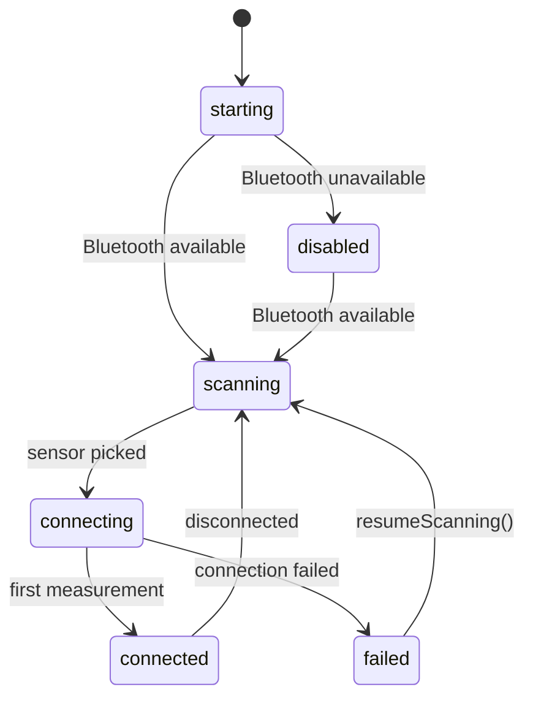

# BLE Heart Rate Monitor Demo

An iOS demo app showcasing **Bluetooth Low Energy** communication using SwiftUI, Combine, and CoreBluetooth. This project connects to a BLE heart rate sensor and displays real-time BPM values with animated feedback.

There is also a companion [ESP32 HR Simulator](https://github.com/ondrejhanak/blehr-sim) for easier testing, especially of 16-bit values as described below.

## Features

- Scans for BLE peripherals advertising the **Heart Rate Service** (`UUID 0x180D`)
- Subscribes to the **Heart Rate Measurement** characteristic (`UUID 0x2A37`)
- Lists discovered sensors by signal strength and drops ones that stop advertising
- Displays incoming heart rate values with heartbeat animation
- Reports a failed connection and offers to resume scanning
- Keeps reading while backgrounded (`bluetooth-central`)
- Handles both **8-bit and 16-bit heart rate formats**, as specified in the [Heart Rate Profile](https://www.bluetooth.com/specifications/specs/html/?src=HRS_v1.0/out/en/index-en.html#UUID-967df1d3-6c3f-f480-6ac4-dc1ed6444fca)
- Written in the **Swift 6 language mode**

## Architecture

CoreBluetooth is confined to a single adapter. `SensorService` holds the state machine and talks to the radio through `BluetoothCentralType`, a protocol it owns - so the dependency points inward and the service can be driven entirely from tests.

| Folder | Depends on | Frameworks |
| --- | --- | --- |
| `Sensor` | nothing | Foundation, Combine |
| `Bluetooth` | `Sensor` | Foundation, CoreBluetooth |
| `UI` | `Sensor` | Foundation, Combine, SwiftUI, UIKit |
| `App` | all | Foundation, SwiftUI |

The view observes a single `SensorState`:

Every state also moves to `disabled` when Bluetooth becomes unavailable, but only the transition from `starting` is drawn for readability.

## Tests

Parametrized test cases covering the heart rate parser, the discovered-sensor registry, the sensor state machine and the view model. Doubles live in `Tests/Doubles`.

`CoreBluetoothCentral` has no tests by design: it only translates between CoreBluetooth and `BluetoothCentralType` and holds no policy, so everything worth asserting sits above it.

## Requirements

- iOS 17.6+
- Real iOS device (BLE is not available in the simulator)
- Heart rate monitor supporting BLE (some Garmin models are ANT+ only) or the [simulator](https://github.com/ondrejhanak/blehr-sim)

## Screen Recording

